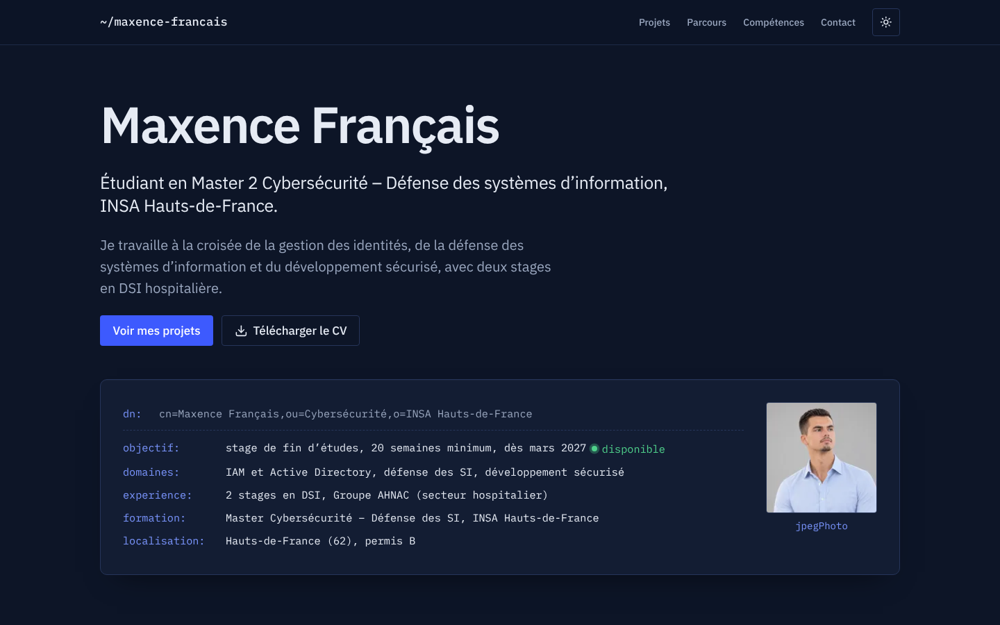

# Portfolio – Maxence Français

Le code de mon portfolio, en ligne sur [miscuitatlas.github.io](https://miscuitatlas.github.io). J'y présente mon parcours, mes stages et une page détaillée par projet, avec captures et liens vers les démos. Mon CV et ma lettre de motivation y sont aussi.



Il remplace la [première version](https://github.com/MiscuitAtlas/portfolio-bootstrap), écrite à la main en Bootstrap. Ici, chaque projet est un fichier Markdown : en ajouter un ne demande plus de toucher au HTML, et le site reste entièrement statique.

## Contenu

- **Accueil** : mon profil présenté comme une fiche d'annuaire (format LDIF), puis les projets, le parcours, les compétences et un formulaire de contact.
- **Études de cas** : une page par projet, avec le contexte, ce que j'ai fait, les résultats et les captures d'écran.
- **Lettre de motivation** et CV en PDF.

**Stack** : Astro, TypeScript en mode strict, contenu en Markdown typé (collections Astro et schémas Zod), CSS natif avec thème clair et sombre, polices IBM Plex hébergées avec le site, GitHub Actions et GitHub Pages.

## Sécurité

- Content Security Policy générée par Astro à chaque build : chaque script et chaque style en ligne est autorisé par son empreinte SHA-256, sans `unsafe-inline`.
- Aucune ressource tierce au chargement : pas de CDN, de police externe ni de traceur.
- Le formulaire de contact passe par Formspree, avec un champ piège contre le spam. Aucun numéro de téléphone ni adresse email n'est publié.

## Développer en local

Prérequis : Node.js 22 ou plus récent.

```bash
npm install
npm run dev          # http://localhost:4321
npm run build        # vérification TypeScript, puis génération du site dans dist/
npm run check:links  # vérifie que tous les liens internes de dist/ existent
npm run preview      # sert dist/ en local (la CSP n'est active qu'ici, pas en mode dev)
```

## Modifier le contenu

| Pour… | Modifier |
| --- | --- |
| Le profil, l'expérience, la formation, les compétences | `src/data/profil.ts` |
| Un projet existant | `src/content/projets/<projet>.md` |
| Ajouter un projet | un fichier `.md` dans `src/content/projets/` et ses images dans `src/assets/projets/` |
| Le CV | `public/cv/CV_Maxence_Francais.pdf` |

Le schéma des projets est défini dans `src/content.config.ts` : s'il manque un champ obligatoire, le build échoue.

## Déploiement

Chaque push sur `main` lance `.github/workflows/deploy.yml` : `astro check`, build, vérification des liens, puis publication du dossier `dist/` sur la branche `gh-pages`, servie par GitHub Pages. Les pull requests sont vérifiées sans être publiées.

## Auteur

**Maxence Français**, étudiant en Master 2 Cybersécurité – Défense des systèmes d'information à l'INSA Hauts-de-France : [LinkedIn](https://www.linkedin.com/in/maxence-fran%C3%A7ais-a039a2307/) · [GitHub](https://github.com/MiscuitAtlas)
